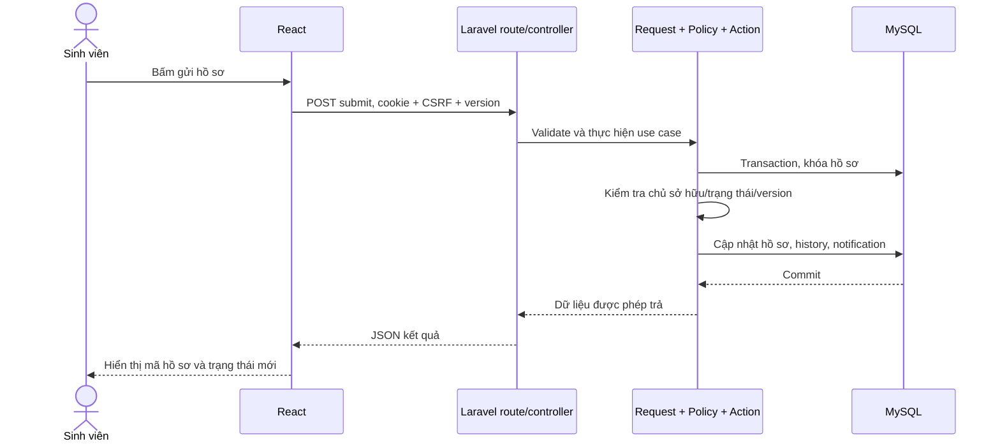
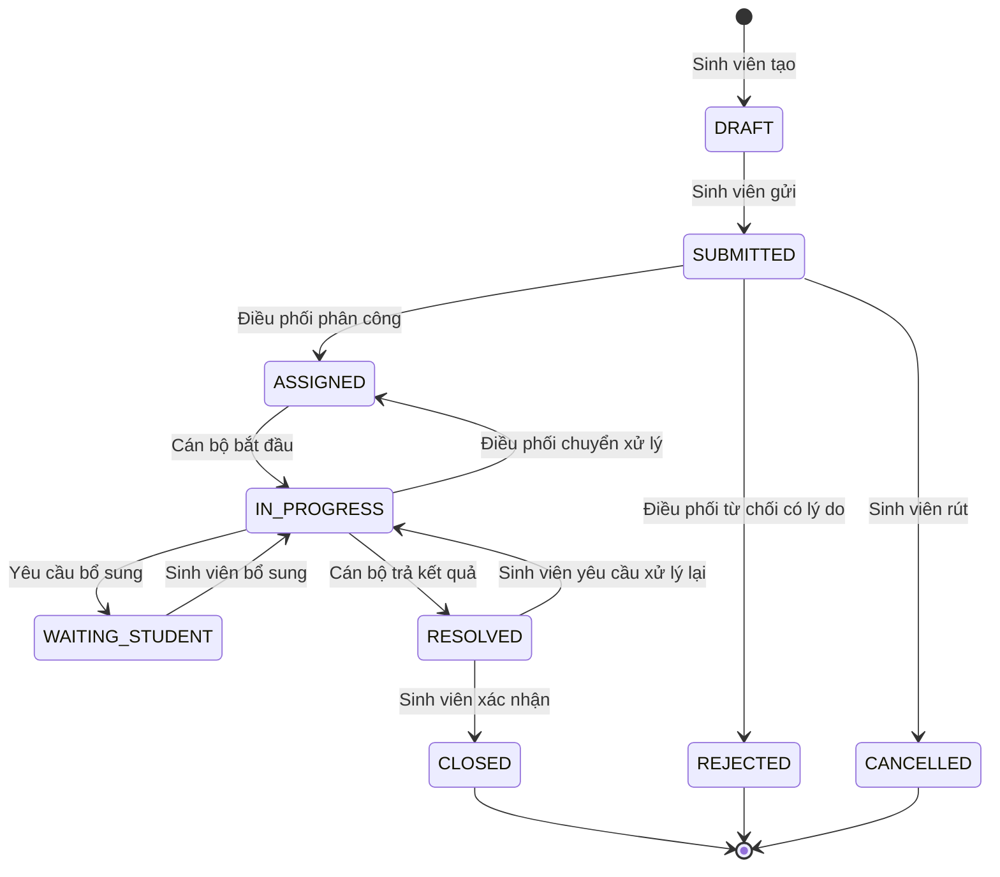

# Giải thích project, hiện trạng và luồng hoạt động

> Tài liệu lưu hiện trạng trước lần triển khai hoàn thiện. Bản đang chạy MySQL, kết quả kiểm thử và giải thích mã hiện tại xem [PROJECT_WALKTHROUGH](PROJECT_WALKTHROUGH.md), [IMPLEMENTATION_REPORT](IMPLEMENTATION_REPORT.md) và [TEST_REPORT](TEST_REPORT.md). Giữ nội dung bên dưới để đối chiếu lịch sử, không dùng bảng trạng thái cũ làm kết luận cho bản bàn giao.

Ngày rà soát: 28/10/2026. Tài liệu dựa trên mã nguồn hiện có và truy vấn chỉ đọc `database/demo3.sqlite`. Lần này chỉ kiểm tra và viết tài liệu/prompt, không triển khai thêm chức năng hoặc chạy lại toàn bộ test của ứng dụng.

## 1. Project giải quyết việc gì?

Hệ thống là một cổng trao đổi có quy trình giữa sinh viên và nhà trường. Sinh viên gửi phản ánh hoặc kiến nghị, điều phối chuyển đến người phụ trách, cán bộ xử lý, sinh viên nhận kết quả và xác nhận hoàn tất. Mỗi hồ sơ lưu trạng thái, phân công, trao đổi và lịch sử để biết ai đã làm gì.

Ví dụ xuyên suốt: sinh viên phản ánh không đăng nhập được cổng học tập. Điều phối giao cho cán bộ CNTT. Cán bộ yêu cầu ảnh lỗi, sinh viên bổ sung, cán bộ sửa tài khoản và trả kết quả. Sinh viên kiểm tra rồi đóng hồ sơ, đánh giá mức hài lòng.

Phản ánh (FEEDBACK) và kiến nghị (PROPOSAL) là hai loại hồ sơ; chúng dùng chung quy trình xử lý trong MVP.

## 2. Nói rõ mức độ hoàn thành hiện tại

Bản hiện tại đã có nhiều thành phần hơn dashboard, nhưng chưa đủ để nghiệm thu toàn bộ yêu cầu đồ án. Lần bàn giao trước đã nói “hoàn thành phần demo”; cần hiểu là đã bổ sung các màn hình demo, không phải tất cả yêu cầu gốc đã được thực hiện và kiểm thử.

| Phần | Mã nguồn hiện có | Cần hoàn thiện/kiểm chứng |
| --- | --- | --- |
| Nền tảng | Laravel 12; lock ghi v12.70.0; React/TSX và Vite | Rà cấu hình/dependency, TypeScript typecheck, scripts chạy trên Laragon |
| Dữ liệu | Migrations, 14 model nghiệp vụ, enums, seeder | MySQL 8.4, ràng buộc còn thiếu, seed đúng chuỗi nghiệp vụ |
| Xác thực | API login/logout/me, session, endpoint CSRF | Test hết phiên, khóa tài khoản, lỗi JSON, giới hạn đăng nhập |
| Hồ sơ | API tạo/sửa nháp, gửi, list/detail, các action xử lý | Quyền từng action, retry, transaction/version, Resource thống nhất |
| Giao diện | Login, dashboard, danh sách, tạo/gửi, detail, phân công và một số action, thông báo | Sửa nháp đầy đủ, tệp, từ chối, chuyển đơn vị, ghi chú nội bộ, đánh giá, pagination/routing |
| Tệp | Model và bảng attachments | Chưa thấy controller/route upload/download private |
| Quản trị | Vai trò ADMIN, dữ liệu nền/model | Chưa thấy API và màn hình CRUD quản trị |
| Báo cáo | Dashboard tổng hợp cơ bản | Báo cáo lọc ngày/danh mục/đơn vị, kiểm tra scope và số liệu |
| Kiểm thử | TestCase và ExampleTest | Chưa có bộ test nghiệp vụ đầy đủ trong thư mục tests |
| Tài liệu | README quy trình làm việc nhóm | Chưa có bộ tài liệu đồ án và hướng dẫn setup đầy đủ |

“Có API” nghĩa là tìm thấy phần triển khai, chưa đồng nghĩa API đã đúng trong mọi tình huống. Lần rà soát này không chạy browser end-to-end hoặc kiểm thử MySQL, nên không khẳng định các luồng đều đã đạt.

## 3. Các phần mã nguồn đang làm gì?

### Frontend: phần người dùng nhìn và thao tác

`resources/js/app.tsx` chứa hầu hết giao diện hiện tại: Login, App, Shell, DashboardView, TicketsView, NewTicket, DetailView, Assign và NotificationsView.

- App giữ tài khoản, màn hình hiện tại và dữ liệu đã tải.
- Hàm api dùng fetch gọi backend, gửi cookie cùng origin và yêu cầu JSON.
- csrfHeader đọc XSRF-TOKEN để gửi header bảo vệ thao tác ghi dữ liệu. Đây không phải lưu token đăng nhập trong localStorage.
- NewTicket hiện thực hiện liên tiếp tạo nháp -> lưu nội dung -> gửi hồ sơ. Vì thế người dùng thấy giống gửi trực tiếp, chưa có trải nghiệm lưu và mở lại nháp hoàn chỉnh.
- DetailView hiển thị nội dung, trao đổi, người phụ trách và các nút tùy vai trò/trạng thái. Một số nội dung hành động còn dùng window.prompt hoặc lý do cố định.
- TicketsView mới lọc tìm kiếm ở dữ liệu đã tải; App gọi tối đa 50 hồ sơ. Cần thêm phân trang/API filter để không bỏ sót dữ liệu.
- Màn hình đổi bằng React state, chưa thấy router riêng để mở deep link và giữ màn hình khi refresh.

`resources/css/app.css` định nghĩa màu sắc, sidebar, card, bảng, trạng thái và responsive. Một phần CSS còn được nhúng trong app.tsx. Khi hoàn thiện nên tách theo cấu trúc dễ bảo trì và giữ hướng thẩm mỹ người dùng đã chọn.

`resources/views/app.blade.php` là khung HTML chứa điểm gắn React và các asset Vite. `routes/web.php` đưa URL `/` tới khung này; đây là lý do trang đầu hiện ứng dụng thay vì welcome Laravel.

### Backend: phần kiểm tra và xử lý

`routes/api.php` khai báo URL gọi các controller. Các route sử dụng middleware web để có session/cookie/CSRF; route nghiệp vụ yêu cầu đăng nhập.

| File | Vai trò hiện tại |
| --- | --- |
| AuthController.php | Kiểm tra tài khoản/mật khẩu và is_active, tạo/hủy phiên, trả thông tin user |
| TicketController.php | Tạo/sửa/gửi, xem hồ sơ, phân công, bắt đầu, yêu cầu bổ sung, tin nhắn, trả lời, đóng, xử lý lại, từ chối, rút và đánh giá |
| DashboardController.php | Đếm đã gửi, số theo trạng thái, đang mở quá hạn, trung bình/số lượt đánh giá |
| DirectoryController.php | Cấp danh mục/đơn vị/cán bộ cho form chọn; chưa phải API quản trị |
| NotificationController.php | Danh sách thông báo của user và đánh dấu đã đọc |
| app/Support/Access.php | Helper kiểm tra vai trò, quyền xem hồ sơ và quyền nội bộ |
| app/Enums | Giữ tập giá trị vai trò, loại/trạng thái hồ sơ và loại/visibility tin nhắn |

Controller hiện đang gánh nhiều nghiệp vụ. Kiến trúc mục tiêu cần tách Policy, FormRequest, Action/Service và Resource để từng trách nhiệm rõ ràng. Chưa nên mô tả code hiện tại là đã hoàn thiện kiến trúc Modular Monolith theo đầy đủ mô-đun.

### Database: phần lưu bền vững

Migrations mô tả cách tạo/sửa cấu trúc; Model ánh xạ bảng và quan hệ; Seeder đưa dữ liệu mẫu vào. Đây là ba nhiệm vụ khác nhau.

| Nhóm bảng | Ý nghĩa |
| --- | --- |
| users, roles, user_roles | Ai đăng nhập và có vai trò nào |
| departments, department_members, categories | Đơn vị, thành viên và phân loại hồ sơ/SLA |
| tickets | Nội dung gốc, trạng thái, chủ hồ sơ và phân công hiện tại |
| ticket_messages | Trao đổi, yêu cầu/bổ sung, câu trả lời chính thức và nội bộ |
| attachments | Metadata tệp; không phải lưu nguyên file nhị phân trong bảng |
| ticket_assignments | Lịch sử thay đổi người/đơn vị phụ trách |
| ticket_status_history | Lịch sử thay đổi trạng thái |
| notifications | Thông báo theo người nhận |
| ticket_ratings | Một đánh giá cho một hồ sơ đã đóng |
| audit_logs | Nhật ký các thao tác quản trị/nghiệp vụ cần truy vết |

Ví dụ: `tickets.assigned_staff_id` trả lời “ai đang xử lý?”, còn `ticket_assignments` trả lời “trước đó từng giao cho ai?”. Không dùng lịch sử để cấp quyền cho cán bộ cũ sau khi đã chuyển người.

`.env` hiện ghi `DB_CONNECTION=sqlite`; không có dòng DB_DATABASE tường minh trong phần cấu hình đã đọc. Có nhiều file SQLite và máy chủ có thể được chạy với biến môi trường riêng. Vì vậy không thể chỉ nhìn tên file để kết luận database nào đang phục vụ một process. Bản trước đã dùng biến môi trường trỏ `demo3.sqlite`.

## 4. Dữ liệu thực đã kiểm tra

Truy vấn chỉ đọc trên `database/demo3.sqlite` cho kết quả:

| Dữ liệu | Số bản ghi |
| --- | ---: |
| Tài khoản | 26 |
| Vai trò | 4 |
| Đơn vị | 3 |
| Danh mục | 6 |
| Hồ sơ | 100 |
| Lịch sử trạng thái | 232 |
| Lịch sử phân công | 55 |
| Tin nhắn | 143 |
| Tệp đính kèm | 0 |
| Đánh giá | 0 |
| Thông báo | 0 |
| Audit log | 0 |

100 hồ sơ gồm 12 DRAFT và 11 hồ sơ ở mỗi trạng thái còn lại: SUBMITTED, ASSIGNED, IN_PROGRESS, WAITING_STUDENT, RESOLVED, CLOSED, REJECTED, CANCELLED. Như vậy tổng đã gửi trên dataset này là 88, không phải 100.

143 tin nhắn gồm 88 COMMENT công khai, 11 INFO_REQUEST công khai, 22 RESOLUTION công khai và 22 COMMENT STAFF_ONLY. Việc có ghi chú nội bộ trong seed không đồng nghĩa đã có giao diện/API tạo ghi chú nội bộ đầy đủ.

Ba đơn vị: Phòng Công tác sinh viên, Phòng Đào tạo, Trung tâm Công nghệ thông tin. Sáu danh mục: Học bổng và hỗ trợ, Ký túc xá, Lịch học và lớp học, Điểm và kết quả học tập, Tài khoản sinh viên, Cơ sở vật chất.

Seeder định nghĩa 20 sinh viên, 1 điều phối, 4 cán bộ, 1 quản trị. Tài khoản demo chính: student1@demo.local, coordinator@demo.local, staff1@demo.local, admin@demo.local; mật khẩu seed là Password123! và được băm khi tạo. Đây là thông tin seed phục vụ phát triển, không xác nhận đã đăng nhập lại tại thời điểm viết tài liệu.

Những gì cần sửa ở dữ liệu:

- Nhiều hồ sơ mới có tiêu đề “Hồ sơ demo số ...”, nội dung chung, chưa đủ minh họa nghiệp vụ thực tế.
- Một số history bỏ qua bước hoặc không đúng người thực hiện; ví dụ seed có thể ghi DRAFT chuyển thẳng REJECTED/CANCELLED thay vì qua SUBMITTED.
- Một số due_at seed bị tính lùi so với submitted_at để tạo quá hạn; cần tạo quá hạn bằng ngày gửi đủ cũ và SLA hợp lệ.
- Không có seed rating/tệp/notification/audit; dashboard chưa có dữ liệu hài lòng để hiển thị.
- Seeder tạo mới 100 ticket mỗi lần chạy; cần chống nhân đôi khi chạy lặp.

Prompt đề xuất dataset mới có số lượng và đáp án thống kê cố định. Những con số mới đó là mục tiêu cần triển khai, không phải dữ liệu hiện tại đã thay đổi.

## 5. Một thao tác đi từ màn hình đến dữ liệu như thế nào?

Sơ đồ sau mô tả kiến trúc mục tiêu sau hoàn thiện; Action/Service và Policy chưa được tách đầy đủ trong code hiện tại.

Cookie xác định phiên người đăng nhập. CSRF giúp ngăn website khác lạm dụng phiên đó để gửi thao tác ghi. Policy quyết định người này được làm hành động đó trên hồ sơ đó hay không. Database giữ dữ liệu sau khi người dùng tải lại trang hoặc đóng trình duyệt.

Frontend có thể ẩn nút không phù hợp để dễ sử dụng, nhưng backend vẫn phải chặn người tự gọi API trái quyền.

## 6. Luồng nghiệp vụ đầy đủ cần đạt

Đây là quy trình mục tiêu theo đặc tả. Các bước còn thiếu UI hoặc cần sửa quyền/transaction được nêu trong phần hiện trạng; không coi sơ đồ là kết quả test.

Phân công lại từ ASSIGNED về ASSIGNED vẫn phải ghi ticket_assignments dù không đổi status; sơ đồ không biểu diễn mọi thay đổi metadata.

1. Quản trị chuẩn bị tài khoản, đơn vị, cán bộ và danh mục. Quản trị thuần không đọc mọi phản ánh.
2. Sinh viên tạo nháp, nhập nội dung và minh chứng. Chỉ chủ hồ sơ xem nháp.
3. Sinh viên gửi. Hệ thống xác thực nội dung đã lưu, sinh mã, chốt due_at, lưu SUBMITTED, history và thông báo.
4. Điều phối xem hàng đợi, phân loại và giao cho cán bộ thuộc đơn vị hợp lệ. Hồ sơ chuyển ASSIGNED.
5. Cán bộ hiện được giao bấm bắt đầu, chuyển IN_PROGRESS.
6. Nếu thiếu thông tin, cán bộ ghi yêu cầu, chuyển WAITING_STUDENT. Sinh viên bổ sung bằng tin nhắn/tệp, trở lại IN_PROGRESS.
7. Cán bộ gửi kết quả chính thức, chuyển RESOLVED. Đây là “đã trả lời”, chưa phải kết thúc được sinh viên chấp nhận.
8. Sinh viên xác nhận thì chuyển CLOSED, sau đó đánh giá một lần 1–5. Nếu chưa hài lòng, sinh viên yêu cầu xử lý lại có lý do khi còn RESOLVED; hồ sơ về IN_PROGRESS.
9. Dashboard/báo cáo tính lại từ database trong phạm vi quyền. Hồ sơ xử lý lại giữ hạn cũ, nên có thể lập tức quá hạn.

Các nhánh khác: rút chỉ từ SUBMITTED; điều phối từ chối SUBMITTED có lý do; chuyển đơn vị chỉ khi ASSIGNED/IN_PROGRESS và trở lại ASSIGNED; không tự đóng và không mở lại CLOSED trong MVP.

## 7. Những cơ chế cần hiểu để bảo vệ đồ án

- **Transaction:** nhóm cập nhật cần thành công cùng nhau. Ví dụ đổi trạng thái và thêm history không được chỉ thành công một nửa. File trên ổ đĩa cần cơ chế dọn riêng, không tự rollback theo transaction database.
- **Version:** số phiên bản của hồ sơ. Hai người cùng mở v3; người thứ nhất lưu thành v4, người thứ hai gửi v3 phải nhận 409 để không ghi đè âm thầm. Kiểm tra trong transaction sau khi khóa, không chỉ trước khi khóa.
- **Chống gửi lặp:** mạng lỗi có thể khiến người dùng bấm lại. Một UUID ổn định cho lần tạo nháp giúp retry không tạo ticket thứ hai; submit retry cũng không tạo mã/lịch sử/thông báo trùng.
- **Khóa ngoại:** ngăn tham chiếu dữ liệu không tồn tại; khóa ngoại ghép bảo vệ quan hệ cặp đơn vị–cán bộ và tin nhắn–hồ sơ. Vai trò/đang hoạt động còn phải kiểm tra bằng nghiệp vụ.
- **Policy:** kiểm tra hành động cụ thể. Quyền xem hồ sơ không tự động cho phép bắt đầu, trả lời hoặc đóng hồ sơ.
- **Ghi chú nội bộ:** chỉ người được phép mới nhận dữ liệu từ API và tải tệp tương ứng. Ẩn ở giao diện là chưa đủ.
- **Lịch sử và audit:** history ghi thay đổi quy trình; audit ghi thao tác cần truy vết rộng hơn. Không ghi mật khẩu/cookie/token vào log.
- **SLA/due_at:** hạn chốt tại lúc gửi. Chờ bổ sung hoặc chuyển cán bộ không tự kéo dài hạn.

## 8. Các điểm code cần ưu tiên sửa

Đây là kết quả đọc mã, chưa phải kết quả chạy test khai thác hoặc kiểm thử hồi quy:

1. Scope list/dashboard có nhánh STUDENT/STAFF/COORDINATOR nhưng không chặn ADMIN thuần bằng mặc định từ chối. Cần dùng scope quyền chung để không lọt truy vấn rộng.
2. transition dùng điều kiện người phụ trách/điều phối/chủ hồ sơ chung cho nhiều hành động. start không có kiểm tra STAFF riêng; cần Policy theo hành động để sinh viên không gọi start của chính hồ sơ mình.
3. submit kiểm tra version trước transaction và nhận lại title/description/category_id. Cần kiểm tra bản ghi đã khóa, lấy nội dung từ nháp, phân biệt retry đã gửi và version thật sự lỗi thời.
4. message tạo tin nhắn trước khi gọi transaction chuyển trạng thái. Nếu bước sau lỗi có thể còn lại tin nhắn; cần một transaction bao trùm.
5. assertVersion chỉ kiểm tra khi request có version, nhiều action cho phép thiếu version. Cần chốt hợp đồng cập nhật và test cạnh tranh.
6. API list trả Eloquent Model trực tiếp; detail có serializer riêng. Cần Resource nhất quán và tránh trường ngoài quyền.
7. detail đang trả history rỗng cho sinh viên. Cần cung cấp tiến độ công khai an toàn thay vì ẩn toàn bộ.
8. Chưa có upload/download, CRUD quản trị và báo cáo chi tiết trong routes; không thể hoàn thiện chỉ bằng thêm menu.

## 9. Công việc tiếp theo và ý nghĩa

Prompt ở PROMPT_HOAN_THIEN_PROJECT.md yêu cầu triển khai theo thứ tự:

1. Kiểm tra và lập checklist để biết chức năng nào thật sự tồn tại/đã test/còn thiếu.
2. Hoàn thiện MySQL, schema và dữ liệu để các chức năng xây trên dữ liệu nhất quán.
3. Tách và sửa quyền/workflow/transaction trước khi mở rộng giao diện.
4. Hoàn thiện màn hình từng vai trò, nháp, file, xử lý và đánh giá để chạy hết luồng bằng UI.
5. Bổ sung quản trị/báo cáo/thông báo với cùng quy tắc quyền.
6. Tạo seed có tình huống cụ thể và thống kê kiểm chứng được.
7. Chạy test nghiệp vụ, MySQL, typecheck/build và browser end-to-end; sửa lỗi phát hiện.
8. Đồng bộ tài liệu, hướng dẫn dùng và kịch bản demo.

Kết quả mong đợi là một bản đồ án chạy từ đầu đến cuối, kèm bằng chứng kiểm thử và giải thích đủ để lần theo mã nguồn. Các bước này mới là phạm vi công việc được mô tả trong prompt; lần viết tài liệu này chưa thực hiện chúng.
